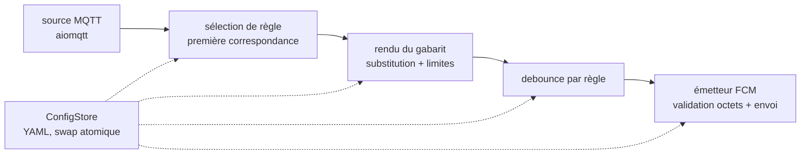
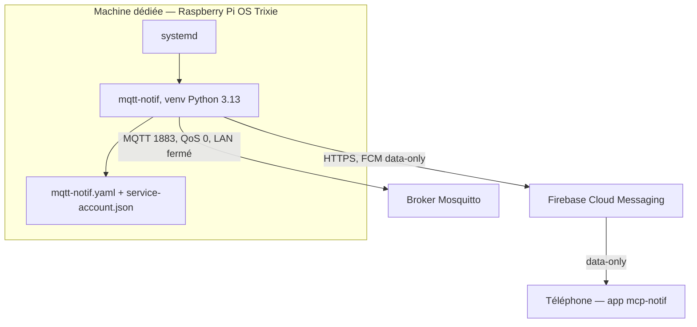

# Architecture Spine — mqtt-notif

## Design Paradigm

Pipeline d'événements unidirectionnel, mono-processus : un message MQTT traverse des étapes pures qui aboutissent à un unique point de sortie FCM. Aucune étape ne connaît les autres que sa voisine aval.



Le ConfigStore n'est pas une étape du flux : les étapes le lisent, jamais l'inverse. Sens unique strict — aucun retour d'information vers l'amont, aucune écriture latérale.

## Invariants & Rules

### AD-1 — Pipeline unidirectionnel

- **Binds:** all
- **Prevents:** des unités construites séparément qui s'appellent en croisé (une règle qui enverrait elle-même en FCM, un watcher qui publierait en MQTT) et rendent le flux invérifiable.
- **Rule:** les étapes ne communiquent que par passage de valeur à l'étape suivante, dans l'ordre source → sélection → rendu → debounce → émetteur. Aucune étape n'appelle une étape non adjacente ni n'écrit dans son état.

### AD-2 — Boucle d'événements unique

- **Binds:** all
- **Prevents:** deux modèles de concurrence coexistants (threads applicatifs + asyncio) avec locks implicites et courses sur l'état de debounce.
- **Rule:** tout s'exécute sur une seule boucle asyncio ; les appels bloquants (firebase-admin, lecture fichier) passent par `asyncio.to_thread` ; aucun thread applicatif. Le timer de debounce est un `asyncio.sleep`, pas un thread.

### AD-3 — ConfigStore unique, swap atomique

- **Binds:** FR-3, FR-7, FR-8
- **Prevents:** deux lecteurs du YAML (pipeline + reloader) qui voient des règles différentes au même instant, ou une config à moitié chargée.
- **Rule:** un seul objet ConfigStore détient les règles ; toute relecture valide le fichier intégralement (schéma + limites + syntaxe des gabarits) avant de remplacer l'ancien en une opération atomique ; un YAML invalide laisse les règles précédentes actives et journalise l'erreur. Aucune autre unité ne lit le fichier YAML. Au swap, la source MQTT resynchronise ses souscriptions avec les topics des règles actives (abonnement des nouveaux, désabonnement des disparus).

### AD-4 — Première règle gagnante, au plus une notification par message

- **Binds:** FR-2, FR-4, SM-C1
- **Prevents:** des règles à motifs qui se chevauchent et déclenchent chacune leur notification — le double-notifié interdit par la contre-métrique SM-C1.
- **Rule:** un message MQTT est confronté aux règles dans l'ordre de déclaration ; la première règle dont le topic (exact ou motif `+`/`#`) correspond traite le message et les suivantes sont ignorées ; si plusieurs règles correspondent, un avertissement est journalisé ; si aucune ne correspond, le message est ignoré (journalisé en debug).

### AD-5 — Syntaxe de substitution unique dans les gabarits

- **Binds:** FR-3, FR-4
- **Prevents:** chaque règle (ou chaque builder) qui invente sa syntaxe de gabarit — `${...}`, `%(...)s`, Jinja — et des moteurs de rendu divergents.
- **Rule:** une seule syntaxe de substitution, résolue contre le payload du message. Chaque règle déclare son format de payload : `json` (défaut) ou `raw` (texte brut). En `json`, les placeholders parcourent le dict parsé ; en `raw`, un unique placeholder expose le message brut décodé en UTF-8 :

```text
{action}            champ racine du payload (mode json)
{capteur.lieu}       chemin pointé imbriqué (mode json)
{payload}            message brut entier (mode raw, seul placeholder autorise)
``` Un champ référencé absent produit le texte de remplacement fixe `[absent]`, jamais une exception ; en `json`, un payload non parsable est traité comme si tous ses champs étaient absents (rendu avec `[absent]`, avertissement journalisé), jamais ignoré en bloc. Aucune fonction, filtre ni logique scriptée dans les gabarits — substitution de champs uniquement. Grammaire fixe : un gabarit est du texte littéral parsemé de placeholders ; un placeholder est un chemin pointé sans espace ; `{{` produit un `{` littéral. La syntaxe de chaque gabarit est validée au chargement de la config, pas seulement au rendu.

### AD-6 — Frontière FCM à rédacteur unique

- **Binds:** FR-5, FR-6, SM-1
- **Prevents:** des unités qui court-circuitent l'émetteur et envoient un message hors limites ou corrompu à l'app mcp-notif.
- **Rule:** seul le module émetteur construit et envoie le message FCM (data-only, clés `title`, `short_message`, `detailed_message` — ce dernier optionnel : absent, seuls le titre et le message court sont envoyés, et l'app affiche le rendu Markdown de `detailed_message` avec repli sur `short_message`). Avant tout appel FCM, il valide : `title` et `short_message` non vides, tailles en octets UTF-8 (≤ 100 / ≤ 500 / ≤ 3500) ; un rendu hors limites est tronqué proprement aux limites, jamais envoyé corrompu. L'envoi est adressé par device token, jamais par `fid`. Les erreurs FCM mappent une politique fixe : `unregistered`, `invalid_argument` et `permission_denied` → journalisées, pas de retry ; `throttled`, `internal`, `network_error` → retry avec backoff borné ; device token absent de la config → erreur explicite journalisée, le service continue ; aucune erreur d'envoi n'arrête le service.

### AD-7 — Debounce en mémoire, propriété du pipeline

- **Binds:** FR-8
- **Prevents:** deux implémentations du debounce (côté règle et côté émetteur) qui doubleraient ou annuleraient le délai, et des fenêtres qui survivent ou disparaissent différemment selon l'unité qui les gère.
- **Rule:** le debounce vit exclusivement dans l'étape dédiée, comme horodatage en mémoire par règle ; la fenêtre s'ouvre à la réception du message, pas à l'envoi de la notification ; la clé est le nom unique de la règle (l'unicité des noms est exigée par le schéma YAML) ; message reçu pendant la fenêtre → ignoré (journalisé en debug) ; une règle sans délai configuré notifie chaque message ; au swap de config, les fenêtres des règles disparues sont purgées et celles des règles conservées persistent ; l'état n'est jamais persisté ni partagé avec une autre étape.

### AD-8 — Enveloppe opérationnelle : service systemd, pas de conteneur

- **Binds:** FR-1, FR-6, SM-1
- **Prevents:** un dimensionnement déploiement divergent (conteneur vs natif) et des chemins de config/secrets non reproductibles d'une unité à l'autre.
- **Rule:** mqtt-notif tourne en service systemd (`Restart=on-failure`) sur la machine dédiée du réseau domestique, venv Python dédié ; reconnexion au broker automatique avec backoff croissant, journalisée ; logs plats sur stdout, confiés à journald ; le chemin du fichier de règles et celui des identifiants FCM (fichier service-account, permissions restreintes) sont passés en variables d'environnement par l'unité systemd ; aucun conteneur, aucune base de données.

### AD-9 — Aucune persistance, perte assumée

- **Binds:** FR-1, FR-8
- **Prevents:** un builder qui ajoute file durable ou base locale « au cas où » pendant qu'un autre suppose l'état volatile — deux mondes incompatibles.
- **Rule:** aucun état n'est persisté sur disque ; souscription en QoS 0 ; les messages reçus pendant une indisponibilité du service sont perdus, sans rejeu ; un redémarrage réinitialise les fenêtres de debounce.

### AD-10 — Enveloppe inter-étapes fixe

- **Binds:** all
- **Prevents:** deux étapes construits séparément qui s'échangent des formes différentes (règle relue depuis le ConfigStore dans l'une, figée dans l'autre ; payload brut dans l'une, dict parsé dans l'autre).
- **Rule:** les étapes s'échangent un objet événement unique : topic (str), payload (dict parsé pour une règle `json`, str pour une règle `raw`), règle retenue (valeur figée au moment de la sélection — jamais relue en cours de traitement). L'objet est immuable pour la traversée ; aucun étape ne le modifie.

### AD-11 — Envois FCM découplés de la file

- **Binds:** FR-5, SM-1
- **Prevents:** un envoi lent ou en retry qui retient les messages suivants (SM-1 violé par assemblage) ou deux étapes qui croisent un envoi frais et un envoi retardé.
- **Rule:** chaque envoi FCM, avec ses retries éventuels, s'exécute comme tâche asyncio indépendante du flux principal ; la file n'attend jamais la fin d'un envoi ; l'ordre d'affichage sur le téléphone n'est pas garanti (accepté).

## Consistency Conventions

| Concern | Convention |
| --- | --- |
| Naming | Python `snake_case`, paquet `mqtt_notif` ; topics MQTT en minuscules (`home/lieu/action`) ; clés du YAML en `snake_case` |
| Data & formats | Limites de taille comptées en octets UTF-8 ; timestamps de journal en ISO 8601 UTC ; `payload_format` par règle : `json` (défaut) ou `raw` ; `debounce_ms` en millisecondes, bornes [0, 3 600 000] (0 = pas de debounce) ; noms de règles uniques |
| State & cross-cutting | Journalisation sur stdout (journald) : une ligne par connexion/déconnexion/reconnexion, rechargement, envoi, erreur ; les erreurs ne sont jamais fatales après le démarrage ; la configuration ne se lit que dans le ConfigStore ; device token renseigné manuellement dans le YAML (décision QO1 du PRD — lecture du store SQLite et enrôlement dédié écartés) |
| Affichage | Tout ce qui est rendu à l'écran (écran verrouillé, Markdown) appartient à l'app mcp-notif ; mqtt-notif n'envoie que des données |

## Stack

| Name | Version |
| --- | --- |
| Python | 3.13 |
| aiomqtt | 2.5.1 |
| paho-mqtt | 2.1.0 (transitif, imposé par aiomqtt) |
| firebase-admin | 7.7.0 |
| PyYAML | 6.0.3 |
| Raspberry Pi OS | Trixie (Debian 13) |

## Structural Seed

```text
mqtt-notif/
  mqtt_notif/
    main.py        # assemblage, boucle asyncio, signals
    config.py      # ConfigStore : schéma YAML, validation, swap atomique, watcher mtime
    mqtt.py        # source MQTT : connexion, souscriptions, reconnexion (aiomqtt)
    rules.py       # sélection de règle : première correspondance (AD-4)
    render.py      # rendu des gabarits : substitution + limites (AD-5)
    debounce.py    # fenêtres par règle, en mémoire (AD-7)
    notifier.py    # frontière FCM : validation octets, envoi, politique d'erreurs (AD-6)
  config/mqtt-notif.yaml    # nom par defaut du fichier de regles (chemin reel passe par variable d'environnement, AD-8)
  deploy/mqtt-notif.service # unite systemd (AD-8)
```



## Capability → Architecture Map

| Capability / Area | Lives in | Governed by |
| --- | --- | --- |
| FR-1 connexion, souscription, reconnexion | `mqtt.py` | AD-1, AD-2, AD-8 |
| FR-2 filtrage topic / motif | `rules.py` | AD-4 |
| FR-3 définition des règles | `config.py` | AD-3 |
| FR-4 personnalisation par type d'événement | `render.py` | AD-5 |
| FR-5 envoi FCM direct | `notifier.py` | AD-6, AD-9, AD-11 |
| FR-6 device token | `config.py`, `notifier.py` | AD-3, AD-6, AD-8 |
| FR-7 rechargement à chaud | `config.py`, `mqtt.py` | AD-3, AD-2 |
| FR-8 debounce | `debounce.py` | AD-7, AD-9 |
| SM-1 latence < 2 s | pipeline entier | AD-1, AD-2, AD-11 |
| SM-C1 au plus une notification | `rules.py` | AD-4 |
| SM-2 YAML effectif sans redémarrage | `config.py` | AD-3, AD-2 |

## Deferred

- Arborescence fine au-delà du seed (modules internes, découpage des tests) — le code en décidera à mesure.
- Stratégie de test (pytest, mocks broker/FCM) — niveau story/epic, pas d'impact inter-unités.
- Constantes : backoff max, nombre de retries, période de sondage mtime, texte exact des messages de log — réglages d'implémentation.
- Permissions exactes du fichier service-account et durcissement de l'unité systemd — au déploiement.
- Authentification broker / TLS — exclu du PRD v1, rouvert si le réseau s'ouvre.
- Multi-appareil, plusieurs tokens — exclu du PRD v1.
- Interface web ou API de gestion — exclu du PRD v1, le YAML est la seule surface de configuration.
- Historique et regroupement de notifications — exclus du PRD v1 (le regroupement relève de l'app Android, qui n'est pas modifiée).

## Open Questions

- À confirmer sur le broker réel : quels topics publient du JSON et lesquels publient du brut — chaque règle tranchera `json` ou `raw` dans le YAML (AD-5).

Tranché le 2026-09-28 : asyncio/aiomqtt retenu ; un seul YAML pour broker + token + règles ; Raspberry Pi OS Trixie livre Python 3.13 (paquet Debian `python3 3.13.5-1`) ; le contrat FCM de l'app mcp-notif (clés, limites, `detailed_message` Markdown avec repli) confirmé contre le code réel de l'app.
