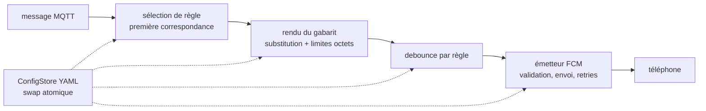

# mqtt-notif — Solution Design

Document de lecture et de discussion, compagnon de l'`ARCHITECTURE-SPINE.md` (la spine fait foi ; ce document explique et met en scène). Rédigé le 2026-09-28 à partir du PRD final et de son addendum technique.

## 1. Le problème, en une phrase

Le réseau domotique publie des événements sur MQTT ; le téléphone de Brfw9455 sait déjà afficher des notifications (app mcp-notif) ; il manque entre les deux un petit démon qui traduit chaque type d'événement en message personnalisé, piloté par un fichier YAML, sans jamais redéployer.

## 2. Vue d'ensemble


mqtt-notif est un démon unique, sans interface, sans base de données, sans état sur disque. Il vit d'une seule boucle de traitement :



Le fichier YAML est le seul point de pilotage : il définit le broker, le device token du téléphone, les identifiants Firebase et la liste des règles. Une modification prend effet sans redémarrage ; un YAML invalide est rejeté en conservant les règles précédentes.

## 3. Pourquoi ces choix

### 3.1 Un pipeline, pas une architecture en couches

Le besoin est une traduction point à point : un message entre, une notification sort. Un pipeline unidirectionnel (source → sélection → rendu → debounce → émission) rend chaque étape testable en isolation et le flux vérifiable d'un coup d'œil. Une architecture hexagonale — celle du serveur MCP existant — est justifiée quand on expose des outils à des clients variés ; ici elle ajouterait de la cérémonie sans empêcher la moindre divergence.

Chaque étape est pur : il reçoit un événement immuable (topic, payload, règle retenue figée) et rend un résultat, sans toucher à l'état des autres.

### 3.2 Une seule boucle asyncio

Deux activités asynchrones cohabitent : consommer MQTT et surveiller le YAML. En asyncio, le debounce devient un simple `asyncio.sleep`, le rechargement une tâche à côté du flux, et aucun lock n'est nécessaire. L'alternative à base de threads paho (loop_start + queue + threads) fonctionne aussi, mais y réfléchir — fenêtres de debounce, timers de retry — devient vite délicat. Les appels Firebase, bloquants, sont isolés via `asyncio.to_thread` (threads utilitaires, pas de threads applicatifs).

Les envois FCM partent chacun comme une tâche indépendante : un envoi lent ou en retry ne retient jamais les messages suivants — c'est ce qui protège la latence de 2 secondes (SM-1). Conséquence assumée : l'ordre d'affichage sur le téléphone n'est pas garanti.

### 3.3 L'envoi FCM direct, et le contrat à ne pas casser

Le PRD a tranché : mqtt-notif envoie lui-même via FCM (firebase-admin), sans passer par le serveur MCP de mcp-notif. L'app Android ne change pas ; elle impose son contrat, confirmé contre son code réel :

- message **data-only**, clés `title`, `short_message`, `detailed_message` ;
- `title` et `short_message` non vides, ≤ 100 et ≤ 500 octets UTF-8 ; `detailed_message` optionnel, ≤ 3 500 octets, rendu en Markdown par l'app (repli sur `short_message`) ;
- adressage par device token (jamais par `fid`), token copié manuellement dans le YAML — la rotation par Firebase impose une édition du fichier, c'est le compromis accepté contre la duplication de l'enrôlement.

Un seul module écrit ce contrat. Il valide avant chaque envoi, tronque proprement plutôt que d'envoyer corrompu, et mappe les erreurs FCM : `unregistered`, `invalid_argument`, `permission_denied` → journalisées sans retry (un token mort ne guérit pas en réessayant) ; `throttled`, `internal`, `network_error` → retry avec backoff borné. Aucune erreur d'envoi n'arrête le service.

### 3.4 Les règles et le YAML

Un seul fichier, édité à la main, rechargé à chaud :

```yaml
broker:
  host: 192.168.1.10
  port: 1883

device_token: "copie-manuelle-du-token-fcm"

rules:
  bouton-salon:
    topic: home/salon/bouton
    payload_format: json          # json (defaut) ou raw
    title: "Salon"
    short_message: "Bouton appuye ({action})"
    detailed_message: "Le bouton du salon a ete appuye : **{action}**"
    debounce_ms: 1000             # optionnel
```

Les points fixés par la spine, là où deux implémentations partiraient en désordre :

- **Première règle gagnante.** Les règles sont évaluées dans l'ordre de déclaration ; la première dont le topic correspond (exact ou motif `+`/`#`) traite le message. Un événement ne notifie jamais deux fois (SM-C1) ; aucune correspondance, rien ne se passe.
- **Une syntaxe de gabarit.** `{capteur.lieu}` (chemin pointé) parcourt le payload JSON ; en mode `raw`, `{payload}` seul expose le message brut. `{{` produit un `{` littéral. Un champ absent rend le texte `[absent]`, jamais une exception ; en mode `json`, un payload non parsable est rendu comme si tous ses champs étaient absents, avec un avertissement journalisé. Les gabarits sont validés au chargement de la config.
- **Debounce simple.** `debounce_ms` par règle, fenêtre ouverte à la réception, horodatage en mémoire ; au rechargement, les fenêtres des règles disparues sont purgées, celles des règles conservées persistent.

### 3.5 Perte assumée, ops réduits

Pas de persistance, pas de rejeu : souscription QoS 0, les messages reçus pendant une indisponibilité sont perdus. Pour un bouton d'avertissement domestique, c'est le bon compromis — une file durable serait de la complexité au service d'un cas qui n'existe pas.

Côté exploitation : un service systemd (`Restart=on-failure`), un venv Python 3.13, des logs plats sur stdout confiés à journald (une ligne par connexion, déconnexion, reconnexion, rechargement, envoi, erreur), les chemins du YAML et du service-account passés par des variables d'environnement. Pas de conteneur : un démon unique sur une machine dédiée n'en a pas besoin, et systemd suffira à des années de vie silencieuse.

## 4. Ce que ce design ne décide pas

Découpage fin des tests, constantes de retry et de backoff, durcissement de l'unité systemd, permissions exactes du fichier service-account, authentification broker/TLS (réseau fermé, v1), multi-appareil, interface web, historique de notifications — tout cela est explicitement reporté ou exclu, et listé dans la section Deferred de la spine.

Reste une seule question à trancher au moment d'écrire les règles réelles : quels topics du broker publient du JSON, lesquels publient du brut — chaque règle le déclare (`payload_format: json|raw`).

## 5. La stack

| Composant | Choix | Version |
| --- | --- | --- |
| Langage | Python | 3.13 (livré par Raspberry Pi OS Trixie) |
| MQTT | aiomqtt (enveloppe asyncio de paho-mqtt) | 2.5.1 |
| MQTT (transitif) | paho-mqtt | 2.1.0 (imposé par aiomqtt) |
| FCM | firebase-admin | 7.7.0 |
| Config | PyYAML | 6.0.3 |
| Exploitation | systemd + journald | — |

Versions vérifiées le 2026-09-28 sur PyPI, les paquets Debian et le code réel de l'app mcp-notif.
